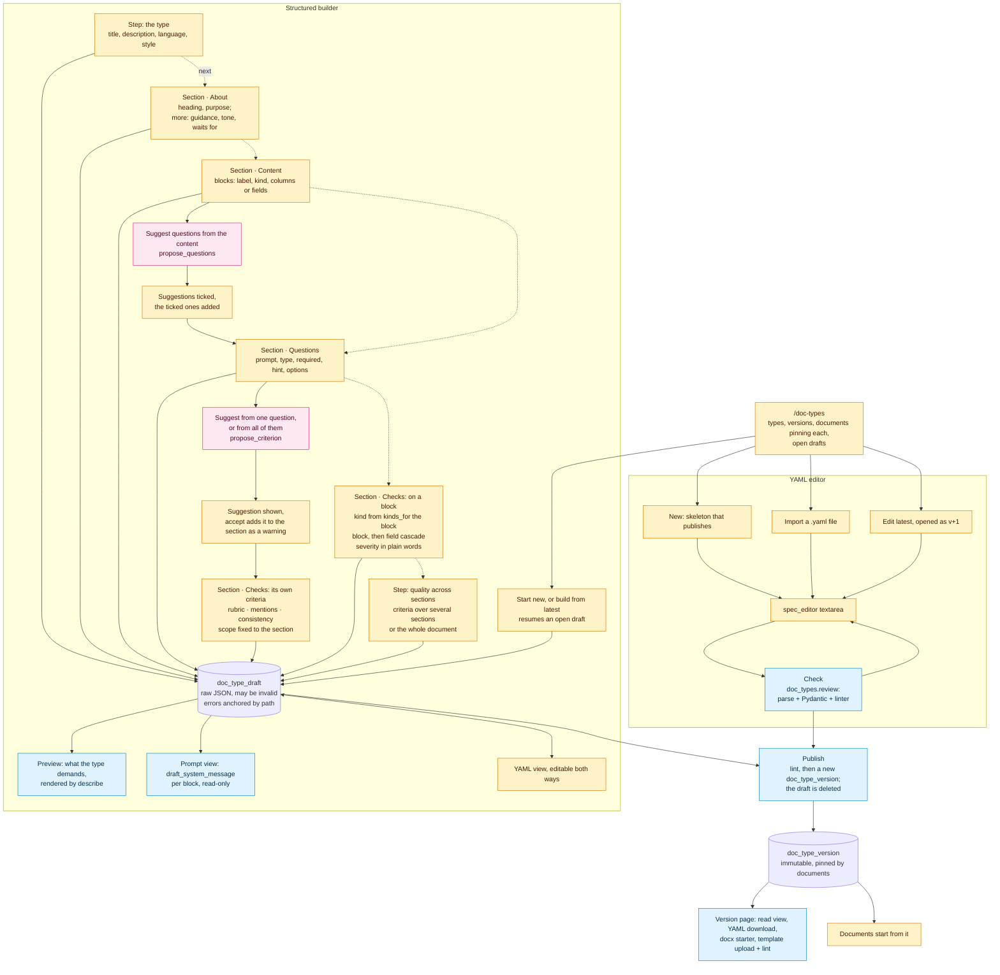
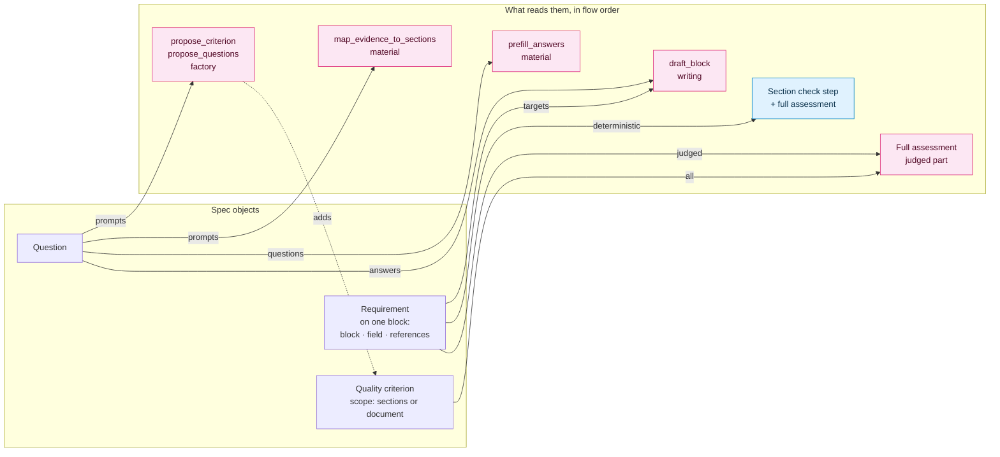

# Lancy Content Flow — Flows

> Companions: [ARCHITECTURE.md](ARCHITECTURE.md) · [BACKLOG.md](BACKLOG.md)

How material, answers, content and checks move through the application as it is built. Three
charts: the document flow, the doctype factory, and the spec objects with what reads each of them.

Every chart colours its steps the same way:

| Colour | Step |
|---|---|
| Rose | A model call |
| Blue | Program logic: parsing, rules, gates |
| Amber | A person decides or types |
| Cylinder, default colour | A stored row |

## 1. The document flow

One document, pinned to one published version. The guided steps are the rail: material, then each
section in dependency order (its questions one at a time, the writing, the section's check), then
the quality check and the export.

```mermaid
flowchart TD
    subgraph MATERIAL["Material step"]
        paste["Author pastes notes"]
        desk["Evidence desk findings<br/>exported as Markdown"]
        item[("evidence_item<br/>verbatim, never edited")]
        split["split into parts<br/>LCF_INTAKE_CHUNK_CHARS"]
        map["map_evidence_to_sections<br/>one call per part<br/>sees section titles, purposes,<br/>block names, question prompts"]
        link[("evidence_link<br/>section_key + quote<br/>quote verified against paste")]
        none["'none': unplaced, never filed"]
        prefill["prefill_answers<br/>one call per section with questions<br/>its passages + up to 3 source parts"]
        proposed[("answer<br/>source = proposed + quote")]

        paste --> item
        desk -. "pasted by hand" .-> paste
        item --> split --> map
        map --> link
        map --> none
        link --> prefill --> proposed
    end

    subgraph SECTION["Each section"]
        q["Question step q-key<br/>confirm · edit · skip"]
        answer[("answer<br/>source = user")]
        gate1{"required answered<br/>and depends_on complete?"}

        draftbtn["Write step:<br/>Write a draft for me"]
        draft["draft_block<br/>one call per empty block<br/>system: style, section, block,<br/>this block's requirements as targets,<br/>never-invent<br/>user: answers, filed passages,<br/>current value, upstream sections"]
        proposal[("proposal<br/>pending")]
        gaps[("gaps<br/>in the job result only,<br/>shown under the block")]
        lane["Assistant lane<br/>revise_block · discuss_block"]
        accept["Accept / edit / save by hand"]
        revision[("revision<br/>the content")]
        stale["Affected sections?<br/>mark_stale"]

        check["Check step<br/>deterministic requirements only:<br/>present, length, rows,<br/>fields_filled, format, cross_ref"]
        gate2{"no blocker failing?"}
        complete["Mark complete<br/>go to next open section"]

        q --> answer --> gate1
        gate1 -- "yes" --> draftbtn --> draft
        gate1 -- "no" --> q
        draft --> proposal
        draft --> gaps
        gaps -. "author fills fields by hand" .-> accept
        proposal --> accept
        lane --> proposal
        accept --> revision
        revision --> lane
        revision --> stale
        revision --> check --> gate2
        gate2 -- "yes" --> complete
        gate2 -- "no, back to writing" --> accept
    end

    subgraph FINISH["Quality check and export"]
        run["Run the full check<br/>assess job"]
        det["Every deterministic requirement"]
        judged["Judged requirements on one block<br/>+ quality criteria over their scope"]
        report[("assessment<br/>check_result rows")]
        gate3{"no blockers and<br/>nothing unevaluated?"}
        export["Export<br/>json · markdown · docx<br/>plain or template"]
        run --> det --> report
        run --> judged --> report
        report --> gate3
        gate3 -- "yes" --> export
    end

    proposed --> q
    link --> draft
    answer --> draft
    complete --> run

    classDef llm fill:#fce7f3,stroke:#db2777,color:#500724
    classDef logic fill:#e0f2fe,stroke:#0284c7,color:#082f49
    classDef human fill:#fef3c7,stroke:#d97706,color:#451a03
    class map,prefill,draft,lane,judged llm
    class split,none,gate1,check,gate2,det,gate3,export,desk logic
    class paste,q,draftbtn,accept,stale,complete,run human
```

## 2. The doctype factory

Two editors over one spec model. The YAML editor is a textarea checked as a whole; the structured
builder is a server-held draft edited a field at a time, walked as steps (dotted): the type, each
section through its phases, the criteria across sections, then publishing. Both publish through `doc_types.publish`,
and a published version is immutable.

## 3. Spec objects and what reads them

Solid edges are references stored in the spec or data passed at runtime. The only spec-level
references are a requirement's `block` (plus `field` and `references`), a criterion's `scope` and a
section's `depends_on`. A question references nothing, and nothing references it.

There is no edge from a question to a requirement or a criterion, and no edge from a criterion to
`draft_block`. The checking consumers read content only: neither sees the answers.

What each consumer is given, in one place:

| Consumer | Questions / answers | Block's requirements | Quality criteria | Content |
|---|---|---|---|---|
| `map_evidence_to_sections` | Question prompts | — | — | Block names, not content |
| `prefill_answers` | The section's questions | — | — | — |
| `draft_block` | Answered values | This block's, as targets | — | This block, upstream sections |
| Section check step | — | Deterministic only | — | This section |
| Full assessment, judged requirement | — | That one requirement | — | That block |
| Full assessment, criterion | — | — | That criterion | Its scoped sections |
| `propose_criterion` | Prompts, hints, options | Existing ones, as sentences | Existing section-scoped titles | — |
